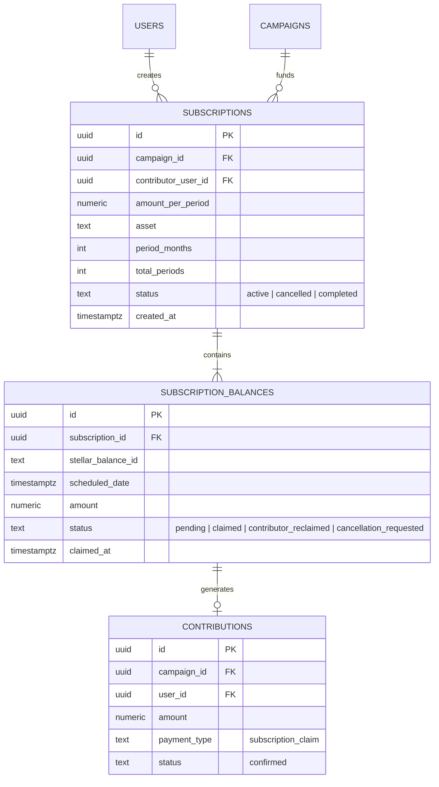

# Canonical Recurring Contribution Subsystem

This document specifies the authoritative design, implementation, data model, operational guarantees, and migration path for the recurring contribution subsystem in CrowdPay.

---

## 1. Executive Summary & Authoritative Implementation

Stellar has no native recurring payment primitive or recurring pull capability. Therefore, recurring contributions in CrowdPay are modeled through **Stellar Claimable Balance Schedules** (the authoritative "Subscription" architecture).

### Authoritative Path: Subscriptions (`/api/campaigns/:id/subscriptions`)
- **Design Philosophy**: Non-custodial or custodial up-front commitment. When a contributor creates a recurring pledge, their full multi-period commitment is committed immediately as discrete on-chain Stellar claimable balances—one balance per billing period.
- **Settlement & Guarantee**: The contributor's wallet locks the funds at creation time. Neither the contributor's wallet nor the platform needs to retain long-term signing keys or custodial permissions to execute periodic charges.
- **Worker Execution**: An automated worker releases each installment to the campaign on its exact scheduled date, provided the campaign remains active and within its deadline.
- **Contributor Control & Reclaim**: Contributors can cancel future installments (greater than 7 days ahead) or reclaim unspent funds directly on-ledger 30 days after the scheduled date if the campaign stops accepting installments.

### Primary Source Components
| Layer | File Path | Responsibility |
|---|---|---|
| **Service Engine** | `backend/src/services/recurring.js` | Subscription lifecycle, claimable balance creation, claiming worker, and cancellation logic. |
| **API Endpoints** | `backend/src/routes/subscriptions.js` | REST routes for creating, preparing (Freighter), submitting, cancelling, and inspecting subscriptions. |
| **Background Worker** | `backend/src/worker.js` | Invokes `startSubscriptionClaimWorker()`. |
| **Frontend UI** | `frontend/src/components/RecurringPledgeForm.jsx` | Contributor UI for configuring frequency (1, 3, 6 months) and locking periods via Freighter or custodial wallet. |
| **Database Migrations**| `backend/db/migrations/20260818_recurring_subscriptions.sql` | `subscriptions` and `subscription_balances` tables and `contributions.payment_type` constraint update. |

---

## 2. Data Model

The canonical schema separates the high-level recurring commitment (`subscriptions`) from its discrete periodic disbursements (`subscription_balances`).

### Table Definitions

#### `subscriptions`
* `id` (`UUID`, PK): Unique subscription identifier.
* `campaign_id` (`UUID`, FK `campaigns(id)`): Campaign receiving the funds.
* `contributor_user_id` (`UUID`, FK `users(id)`): User account funding the subscription.
* `amount_per_period` (`NUMERIC(20, 7)`): Amount disbursed in each installment.
* `asset` (`TEXT`): Asset code (e.g., `XLM`, `USDC`).
* `period_months` (`INTEGER`): Interval between installments (allowed: `1`, `3`, `6` months).
* `total_periods` (`INTEGER`): Total installments committed (allowed: `2` to `24`).
* `status` (`TEXT`): Lifecycle status (`active`, `cancelled`, `completed`).

#### `subscription_balances`
* `id` (`UUID`, PK): Installment record identifier.
* `subscription_id` (`UUID`, FK `subscriptions(id)`): Parent subscription reference.
* `stellar_balance_id` (`TEXT`): Authoritative on-chain Stellar Claimable Balance ID.
* `scheduled_date` (`TIMESTAMPTZ`): Timestamp when the platform claim worker becomes eligible to claim the installment.
* `amount` (`NUMERIC(20, 7)`): Value of this discrete installment.
* `status` (`TEXT`): State of installment (`pending`, `claimed`, `contributor_reclaimed`, `cancellation_requested`).
* `claimed_at` (`TIMESTAMPTZ`): Timestamp when the balance was claimed and settled into the campaign wallet.

---

## 3. Worker Ownership, Retry Behavior & Operational Recovery

### 1. Worker Execution Loop
The subscription claim worker is bootstrapped via `backend/src/worker.js` by calling `startSubscriptionClaimWorker()`.
* **Execution Interval**: Fires once daily (`24 * 60 * 60 * 1000` ms) and runs an initial cycle upon startup.
* **Selection Predicate**: Identifies all balances where `status = 'pending'` and `scheduled_date <= NOW()`.

### 2. Campaign Acceptance Guard (`CAMPAIGN_ACCEPTS_INSTALLMENT_SQL`)
Before claiming any balance on-chain, the worker verifies that the target campaign is valid:
1. `campaign.status = 'active'`
2. `campaign.deleted_at IS NULL`
3. Campaign has not passed its deadline: `(campaign.deadline IS NULL OR scheduled_date < (campaign.deadline + INTERVAL '1 day'))`

If the campaign is completed, suspended, failed, or expired, the worker skips the balance. The balance remains locked until the contributor reclaim window opens.

### 3. Concurrency & Idempotency
- **Optimistic/Transactional Guard**: Claim operations run within database transactions. A balance being claimed is marked or verified atomically.
- **On-Chain Idempotency**: If a claim transaction was previously submitted and confirmed on Horizon, subsequent attempts detect `isClaimableBalanceGoneError` and reconcile local state without double-crediting.
- **Contribution Ledgering**: Upon a successful claim, a record is added to `contributions` with `payment_type = 'subscription_claim'`, updating campaign totals and contributor dashboards.

### 4. Operational Recovery & Failure Handling
- **Transient Network Failures**: Horizon 5xx or RPC timeout errors are logged with context (`subscription_id`, `balance_id`). The balance status remains `pending` and is retried on the next run.
- **Expired/Disqualified Campaigns**: Unclaimed balances automatically become reclaimable by the contributor 30 days after their scheduled date (`CONTRIBUTOR_RECLAIM_AFTER_DAYS = 30`). Contributor reclaim keys are pre-encoded into the Stellar Claimable Balance predicate conditions at creation time.

---

## 4. Superseded Paths & Migration / Removal Plan

### Deprecated Path: Custodial Recurring Cron (`recurringContributionsService.js`)
An earlier implementation (`backend/src/services/recurringContributionsService.js` and table `recurring_contributions`) attempted to run recurring charges by executing off-chain cron jobs that repeatedly called `submitCustodialContribution()` against stored custodial wallets.

#### Why It Is Superseded:
1. **Custodial Limitation**: Only works for custodial accounts where the server holds private keys. Fails completely for non-custodial wallets (Freighter).
2. **Payment Failure Risk**: Contributors may drain funds, resulting in recurring charge failures, failed retries, and unbounded backoff loops.
3. **Canonical Superiority**: The Claimable Balance approach in `recurring.js` guarantees committed liquidity upfront and works uniformly for both non-custodial (Freighter) and custodial donors.

### Migration & Deprecation Plan

| Phase | Milestone | Action |
|---|---|---|
| **Phase 1: Deprecation & Audit (Current)** | Wave 10 | Mark `recurring_contributions` and `recurringContributionsService.js` as deprecated in API documentation and architecture guides. Direct all new frontend flows to `/api/campaigns/:id/subscriptions`. |
| **Phase 2: Drainage & Sunset** | Post-Wave 10 | Disable creation of new rows in `POST /api/users/me/recurring-contributions`. Permit existing active schedules to conclude their billing cycle or invite users to switch to claimable balance subscriptions. |
| **Phase 3: Schema & Code Removal** | Next Major Release | 1. Remove `recurringContributionsService.js` and its hourly cron from `worker.js`. 2. Drop legacy table `recurring_contributions` via a migration script. 3. Remove deprecated `/api/users/me/recurring-contributions` endpoints. |

---

## 5. Subsystem Reference Links

- **API Documentation**: [`backend/API.md`](../backend/API.md#subscriptions)
- **Contributor Documentation**: [`CONTRIBUTING.md`](../CONTRIBUTING.md#working-with-ai-agents)
- **Service Implementation**: [`backend/src/services/recurring.js`](../backend/src/services/recurring.js)
- **Routes & OpenAPI Specs**: [`backend/src/routes/subscriptions.js`](../backend/src/routes/subscriptions.js)
